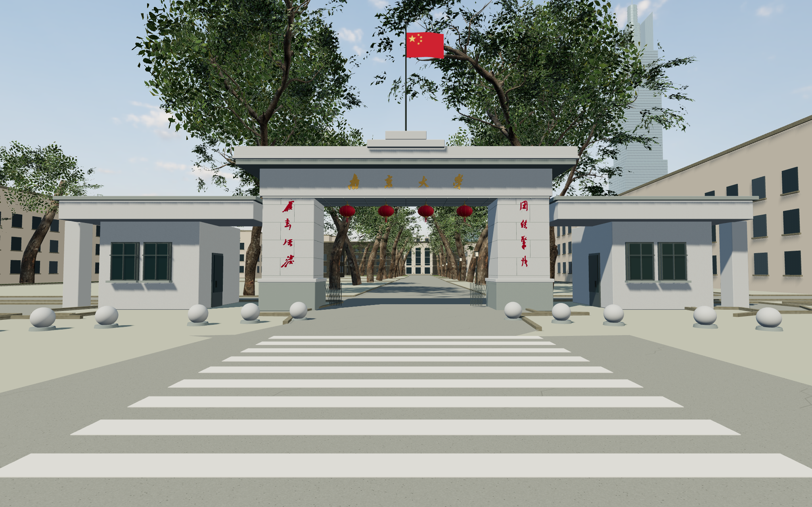

# 鼓楼 · Gulou

在浏览器里，重新走进南京大学。

**当前为本地开发阶段，暂未开放线上试玩。**


这是我与 **GPT-6 Astra** 共同完成的南京大学校园网页游戏。从鼓楼校区开始，希望把熟悉的建筑、道路和校园记忆，变成打开网页就能自由探索的空间。

做这个项目的初衷，是让大家零门槛云游鼓楼，也通过一个能亲手玩的作品，感受 AI 发展的速度。学校 Minecraft 社团的校园复刻做得很不错；对一些想逛逛校园的人来说，购买正版游戏、下载客户端、连接服务器等准备步骤仍有些麻烦。这个项目希望把准备过程简化到“打开网页就能逛”，让同学、校友和对南大感兴趣的人都能轻松走进来。

无需安装客户端，无需注册。支持电脑浏览器和手机触控。手机可使用左侧摇杆移动、拖动画面观察，并通过按钮起飞、升降和切换视角。

## 一起共建

如果你觉得这个项目还不错，欢迎**转发给同学、朋友和校友，也欢迎点一个 Star** ⭐，或[赞赏](#支持这个项目)。

**欢迎指出各种建筑、路线、细节错误，或提供有使用许可的照片、视频等参考素材。**

也欢迎在此基础上扩展新的校区、建筑、角色和玩法，提交代码或模型，或提出有趣的想法。

欢迎通过 [Issues](https://github.com/wang-jiahao/gulou/issues) 交流，或提交 Pull Request，一起把这个游戏慢慢做完整。

## 怎么操作

| 按键 | 操作 |
| --- | --- |
| WASD / 方向键 | 行走、调整飞行方向 |
| 鼠标 | 观察；也可按住拖动 |
| Shift | 加速（步行与飞行） |
| F | 起飞 / 降落 |
| 空格 / Ctrl | 飞行上升 / 下降 |
| V | 第一 / 第三人称 |
| M | 校园地图 / 地标与选点传送 |
| T | 时间与天气 |
| I | 查看附近地点介绍 |
| E | 骑车 / 下车、踢球或拾球投篮、坐下 / 起身等场景互动 |
| R | 在运动场将足球送回中场 |
| P | 拍照 |
| H | 隐藏 / 显示界面 |
| Esc | 释放鼠标 / 设置；全屏时由浏览器退出全屏 |
| 设置 → 返回开始页 | 保留位置与时间，之后可继续漫步 |
| 开始页 / 设置 → 全屏显示 | 在支持网页全屏的浏览器中切换全屏 |

音乐采用每轮洗牌的随机轮播，避免连续重复同一首。设置中可以切歌、暂停、调整音量或导入音频；文件只在浏览器本地播放，不上传。

本机准备了五首 C418 / Minecraft 曲目供本地播放；文件保存在未跟踪的本地目录，不作为仓库资产分发。也可以导入自己的音频。

## 现在可以玩什么

- 在鼓楼校区自由漫步、慢跑，按空格跳跃，切换第一／第三人称；手机可点“跳跃”。
- 靠近地点按 I 或点击“了解……”阅读依据官方资料整理的校园故事。
- 从北大楼经过大礼堂、教学楼、中大路和汉口路校门，继续走进南园。
- 起飞、滑翔、俯瞰校园；降落中可用 WASD 或手机摇杆前后左右调整落点。
- 每次新进入都从晴朗的白天下午开始，时间自动走向黄昏和夜晚，之后天气随机变化；也能手动调整。打开菜单再继续会保留本次时间与天气。
- 在地图查看逐栋编号、搜索建筑和宿舍，快速前往入口；左上角显示所在建筑或附近地点。
- 在四处宿舍车棚，以及新教学楼、图书馆和南教学楼旁的露天停车区按 E 骑自行车，W 前进、鼠标或 A/D 转向、S 减速／倒车、空格刹车、Shift 加速、E 下车；手机可用摇杆和互动按钮。
- 走到南园导览栏，按 E 或点击手机提示查看南园地图。
- 在大纛坪旗杆旁按 E 或点击提示，降下或再次升起国旗，进入校园时默认已升起。
- 沿汉口路、广州路门外的人行道散步，看车辆在人行横道前停车让行。
- 经过人行闸机时自动开门，靠近车辆道闸时抬杆，离开后关闭。
- 切换男生／女生形象与三套日常穿搭，坐一会儿，保存最长边 2048 像素的照片。
- 到松林休憩点坐在石凳上，起身后沿短小径回到校园道路。
- 到 I ❤️ NJU 合影点，斜拍北大楼与紫峰大厦。
- 漫步运动场围网内外，经开放入口进入跑道，走上西侧带顶棚主席台；在篮球场拾球投篮，查看东侧网球场。
- 在苏浙运动场踢球练习：靠近足球轻踢或加力射门，进球计数，也可一键把球送回中场。
- 导入喜欢的本地音乐，在校园里随机轮播。

当前版本包含南园、北园的整体粗模，重点制作北大楼及周边路线，补充了紫峰大厦。普通建筑、部分尺寸和植被位置仍是依据资料的近似重建，欢迎熟悉校园的同学指出不准确的地方。

<details>
<summary>看看空中的校园</summary>


</details>

<details>
<summary>北大楼与紫峰大厦合影机位</summary>


</details>

<details>
<summary>苏浙运动场 · 单人踢球</summary>


通过地图传送到苏浙运动场，走近足球按 E；按住 Shift 踢球会更有力，按 R 可把球送回中场。两端球门都可进球，足球整体越过门线才计分，进球后自动回中场。练习分数在当前页面内保留，刷新后重新开始。

</details>

<details>
<summary>新的人物形象与日常穿搭</summary>


重新调整脸型、眉眼、肤色、发型与服装轮廓。设置中可选择“校园经典”“鼠尾草绿”“暖棕与米白”，会保存在本机；仍是简化的实时角色。

</details>

<details>
<summary>按照片继续完善的汉口路校门</summary>



补充深挑檐、灰色石材分缝、凸起校名与柱面题字、灯笼、门卫窗框和门后树荫；十二字按照片重建笔画轮廓，仍非原书法矢量稿；主门和两侧步行通道保持可通行。尺寸仍属于照片参考下的近似重建。

</details>

## 手机端


支持双指同时移动和转向、横竖屏布局、地图传送，以及触屏起飞和升降。截图来自 Chrome 手机视口与触控模拟；真实手机的表现取决于设备，移动端默认采用较低画质。

<details>
<summary>手机也能踢球</summary>


用摇杆走近足球，点“踢球”；开启“快走”后可以加力射门。

</details>

<!-- work-metrics:start -->
## 开发工作量

统计于 2026-10-09T15:06:54.583Z，代码和资源对应当前 v0.112.0 工作树，Git 截至表内修订。每版运行 `npm run metrics` 刷新；对话用量只在提供本地日志时重采样。token 包含反复发送的上下文，不能视为新增文字量或账单；数据规模也不代表还原准确度。

| 项目 | 数量与统计口径 |
| --- | --- |
| 当前本地版本 | v0.112.0；Git 已提交 128 次（截至 f20f542）；历史及当前工作树共 108 个不同版本号 |
| 游戏源代码 | 12,570 行 / 135 个 TS、CSS、HTML 文件 / 0.90 MiB（含空行与注释，不含 JSON、素材、依赖与测试） |
| 工具与验证脚本 | 12,285 行 / 170 个文件 / 1.10 MiB（单列，不计入游戏代码；未完成宣传片脚本不计） |
| 场景与轮廓数据 | 1 个源 JSON / 0.23 MiB（程序生成数据单列） |
| 游戏静态资源 | 61 个文件 / 37.62 MiB；当前构建目录 41.18 MiB（未压缩磁盘字节，不代表网络传输量） |
| 已收集本地参考图像 | 989 个文件（含全景各面、裁切、重复图和视频帧，未去重；不是独立照片数或逐张阅览数） |
| 本地参考视频 | 4 个文件；其中用户提供的两段漫游作为主要参考，另有补充视频（不随游戏分发） |
| 来源记录 | 52 个不同 URL，见资料来源文档（不代表全部已用于建模；同站不同页面分别计） |
| 已扫描对话范围 | 1 份任务日志 / 11 条用户角色消息（过滤环境注入、心跳和接续摘要；不等于全项目对话轮数） |
| 模型报告 token 用量 | 44,391,580 total；输入 43,628,353（含缓存读取 33,182,410），输出 763,227；上述日志截至 2026-10-04T13:25:58.951Z 的末次累计计数 |
| 实际花费 | 未知；缺少中转账单和可核实的模型单价，不能由 token 数可靠推算金额 |

<!-- work-metrics:end -->

## 开发记录

逐版开发与验证说明、建筑精修进度表、历史截图对照已整理到 [开发历史](docs/development-history.md)。详细本地进度另见 [progress.md](docs/progress.md)。

## 参考资料

主要依据 [南京大学官方 VR 校园](https://vr.nju.edu.cn/newUI/#/)、[鼓楼校区官方平面图](https://zcc.nju.edu.cn/dzdt/glxqdt/index.html)，结合校园漫游视频、用户提供的照片与官方建筑介绍核对。代表图片、视频、来源及用途见 [参考资料导览](docs/reference-guide.md)；分发资产与许可见 [资产说明](docs/asset_sources.md) 和 [第三方资源说明](THIRD_PARTY.md)。项目非南京大学官方产品，也不是精确测绘成果。

## 接下来想做什么

这些是希望和大家一起逐步实现的方向：

- **继续精修汉口路校门**：在现有梁柱、门卫房、校名、国旗和铺装的基础上，继续校对尺寸、绿化和细部。
- **扩展到南京大学四个校区**：鼓楼、仙林、浦口、苏州，逐步连成更完整的南大校园体验。
- **宣传片与简短介绍**：待主要地标和游玩体验较完善后，分镜头采集北大楼、汉口路门、教学楼、图书馆等场景，以及漫步、骑行、俯瞰画面，再统一剪辑；宣传词保持简洁。素材与成片先保存在本地，发布另行决定。
- **完善鼓楼校区周边**：继续制作周围建筑、街道、地铁站及出入口，让校园与附近的城市环境逐步衔接。
- **走进建筑内部**：进入教学楼、图书馆、食堂、宿舍与礼堂，探索有辨识度的室内空间。
- **让场所拥有对应的玩法**：已有操场单人踢球练习与篮球投篮，继续扩展足球玩法、图书馆阅读和礼堂活动。
- **继续打磨校园质感**：更自然的人物与动画、更准确的建筑与道路、更丰富的树木、声音和季节变化。
- **多人联机**：和朋友一起漫步校园、参与活动或协作完成场所玩法。
- **自定义皮肤**：支持不同服装、发型、配色与社区制作的角色皮肤。

## 本地运行与部署

建议 Node.js 22.18+；开发脚本也兼容项目所在电脑的既有 Node 运行时。

```bash
npm install
npm run dev
```

```bash
npm run typecheck
npm run lint
npm run check:assets
npm run build
npm run preview
```

启动本地预览后，`npm run test:flight-wardrobe` 检查高空地面显示与穿搭持久化；`npm run test:football` 可验证桌面／触屏踢球、双端进球、门柱碰撞与暂停；`npm run test:sports` 检查运动场四处通道的步行／骑行、围网碰撞与主席台；`npm run test:teaching-parking` 检查新增25辆单车的选车、骑出、安全下车和入口通行；`npm run test:mobile` 和 `npm run test:gate-photo` 检查手机操作、门洞通行与高清照片导出。

目前仅本地开发，仓库已私有、网页已撤下。`build:pages` 只保留为将来重新获得发布授权后的构建方式，不会自动上传。详见 [部署说明](docs/deployment.md)。

## 技术栈

| 技术 | 用途 |
| --- | --- |
| TypeScript + Vite | 游戏逻辑、界面与静态构建 |
| Three.js / WebGL2 | 实时三维画面、材质、阴影与天气 |
| Rapier | 人物运动、台阶、建筑与飞行碰撞、足球刚体 |
| glTF / GLB + Meshopt | 模型资产与几何压缩 |
| Web Audio / HTML Audio | 环境声与本地音乐播放 |
| GitHub Pages | 将来重新授权发布时可使用的静态托管 |

地图依据官方 VR、校园图与开放数据人工校准；建筑采用重点手工建模与普通建筑程序化生成相结合的方式。

原创代码使用 [MIT License](LICENSE)，第三方数据与素材保留各自许可，详见 [THIRD_PARTY.md](THIRD_PARTY.md)。

## 支持这个项目

从一个想法到整个鼓楼，这个项目投入了大量时间，也消耗了大量 token。如果游戏让你想起一段校园时光，欢迎自愿赞赏或者帮作者点个免费的star。

赞赏完全自愿，所有游玩功能均无需付费。愿意指出问题、提供校园资料，也是一份支持。

<a href="public/assets/support/wechat-appreciation.png"></a>

微信扫码，或保存图片后在微信中识别。[作者主页](https://wang-jiahao.github.io/) · [项目仓库](https://github.com/wang-jiahao/gulou)（当前为私有仓库，访问需要权限）。工作量与 token 统计见上文，统计不等同于实际账单。
