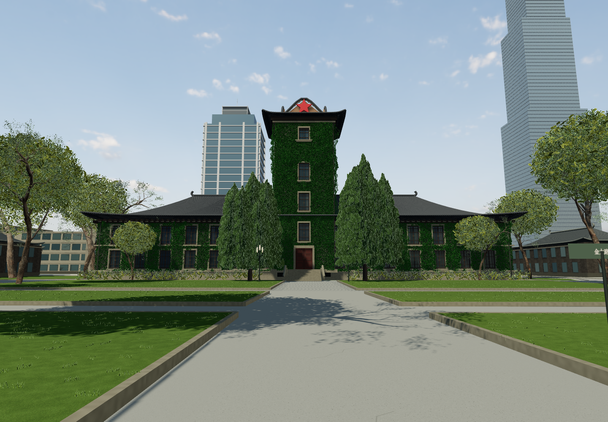
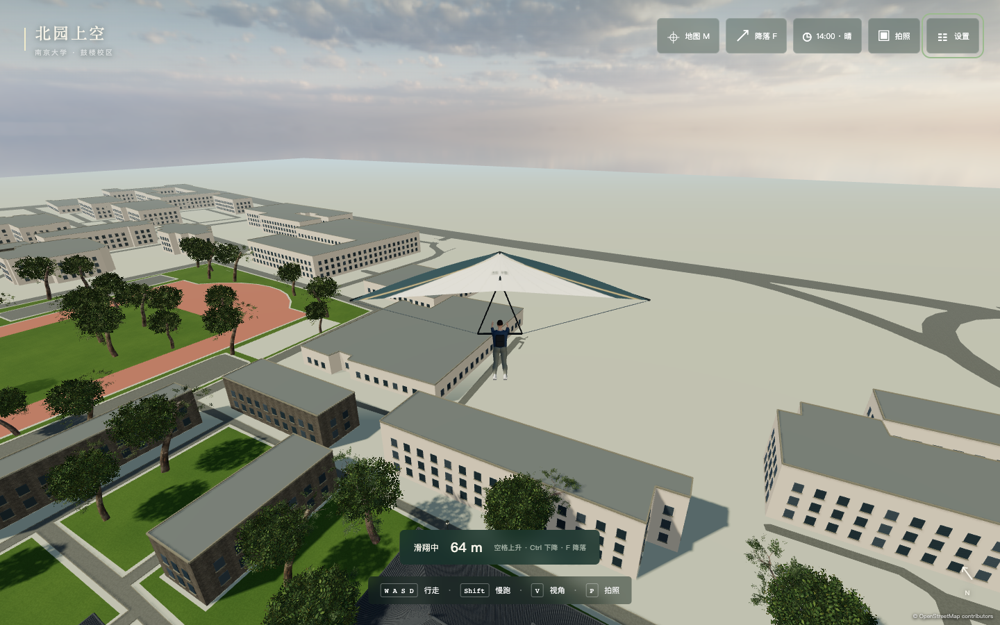
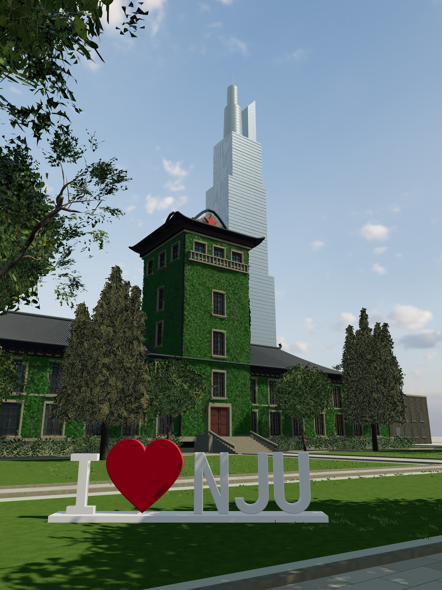
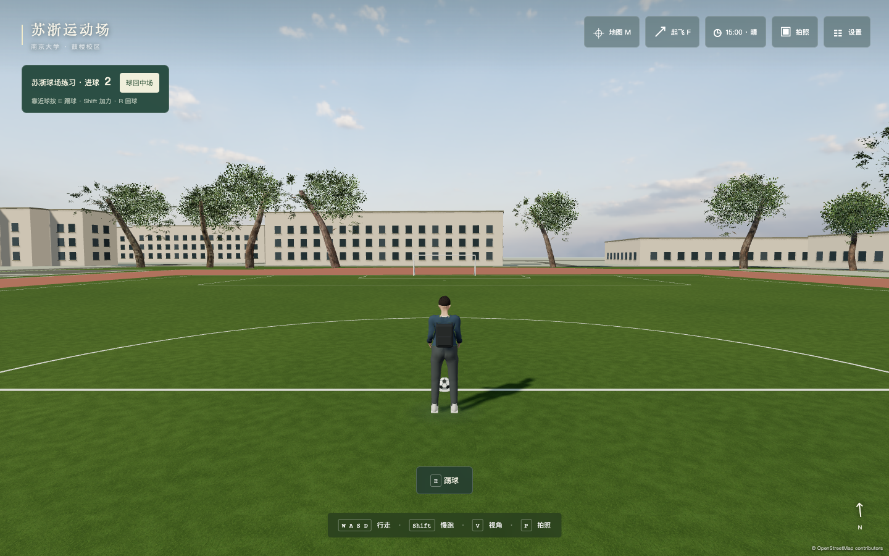
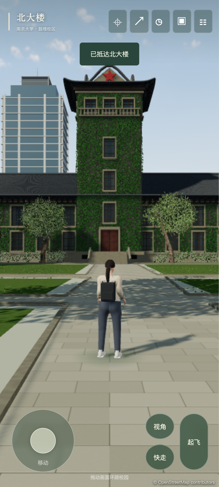
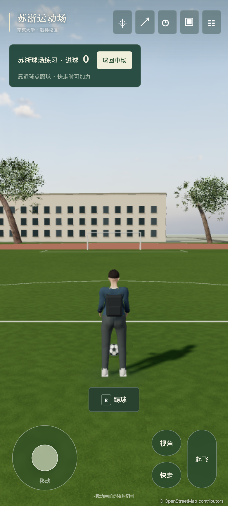

# 鼓楼 · Gulou

在浏览器里，重新走进南京大学。

**当前为本地开发阶段，暂未开放线上试玩。**



这是我与 **GPT-6 Astra** 共同完成的南京大学校园网页游戏。从鼓楼校区开始，希望把熟悉的建筑、道路和校园记忆，变成打开网页就能自由探索的空间。

无需安装客户端，无需注册。支持电脑浏览器和手机触控。手机可使用左侧摇杆移动、拖动画面观察，并通过按钮起飞、升降和切换视角。

## 一起共建

如果你觉得这个项目还不错，欢迎**转发给同学、朋友和校友，也欢迎点一个 Star** ⭐

更欢迎在此基础上扩展新的校区、建筑、角色和玩法。无论是提交代码或模型、补充有使用许可的照片与地图、指出路线错误，还是提出一个有趣的想法，都很有帮助。

欢迎通过 [Issues](https://github.com/wang-jiahao/gulou/issues) 交流，或提交 Pull Request，一起把这个游戏慢慢做完整。

## 现在可以玩什么

- 在鼓楼校区自由漫步、慢跑，切换第一／第三人称。
- 从北大楼经过大礼堂、教学楼、中大路和汉口路校门，继续走进南园。
- 起飞、滑翔、俯瞰校园，再找一处地方降落。
- 看白天变成夜晚，手动切换时间，或者听着真实雨声遇上一场阵雨。
- 在地图任意选点安全传送，或快速前往北大楼、汉口路门等地点。
- 切换男生／女生形象，坐一会儿，保存最长边 2048 像素的照片。
- 到 I ❤️ NJU 合影点，斜拍北大楼与紫峰大厦。
- 在苏浙运动场踢球练习：靠近足球轻踢或加力射门，进球计数，也可一键把球送回中场。
- 导入喜欢的本地音乐，在校园里随机轮播。

当前版本包含南园、北园的整体粗模，重点制作北大楼及周边路线，补充了紫峰大厦。普通建筑、部分尺寸和植被位置仍是依据资料的近似重建，欢迎熟悉校园的同学指出不准确的地方。

<details>
<summary>看看空中的校园</summary>



</details>

<details>
<summary>北大楼与紫峰大厦合影机位</summary>



</details>

<details>
<summary>苏浙运动场 · 单人踢球</summary>



通过地图传送到苏浙运动场，走近足球按 E；按住 Shift 踢球会更有力，按 R 可把球送回中场。两端球门都可进球，足球整体越过门线才计分，进球后自动回中场。练习分数在当前页面内保留，刷新后重新开始。

</details>

## 手机端



支持双指同时移动和转向、横竖屏布局、地图传送，以及触屏起飞和升降。截图来自 Chrome 手机视口与触控模拟；真实手机的表现取决于设备，移动端默认采用较低画质。

<details>
<summary>手机也能踢球</summary>



用摇杆走近足球，点“踢球”；开启“快走”后可以加力射门。

</details>

## 怎么操作

| 按键 | 操作 |
| --- | --- |
| WASD / 方向键 | 行走、调整飞行方向 |
| 鼠标 | 观察；也可按住拖动 |
| Shift | 慢跑 / 飞行加速 |
| F | 起飞 / 降落 |
| 空格 / Ctrl | 飞行上升 / 下降 |
| V | 第一 / 第三人称 |
| M | 校园地图 / 地标与选点传送 |
| T | 时间与天气 |
| E | 踢球、查看附近地点介绍、坐下 / 起身 |
| R | 在运动场将足球送回中场 |
| P | 拍照 |
| H | 隐藏 / 显示界面 |
| Esc | 释放鼠标 / 设置 |

音乐采用每轮洗牌的随机轮播，避免连续重复同一首。设置中可以切歌、暂停、调整音量或导入音频；文件只在浏览器本地播放，不上传。

本机准备了五首 C418 / Minecraft 曲目供本地播放；文件保存在未跟踪的本地目录，不作为仓库资产分发。也可以导入自己的音频。

## 参考资料

最主要的参考是 **[南京大学官方 VR 校园](https://vr.nju.edu.cn/newUI/#/)**：建筑正面、侧面、鸟瞰、道路连接与校园空间关系，都尽量结合多个角度核对。

同时参考了：

- 南京大学鼓楼校区平面图，用于建筑轮廓、道路与南北园布局。
- [南京大学官网](https://www.nju.edu.cn/)的校园介绍与建筑资料。
- [OpenStreetMap](https://www.openstreetmap.org/) 的建筑轮廓和空间基准，相关数据遵循 ODbL。
- [Wikimedia Commons](https://commons.wikimedia.org/) 上的公开建筑照片，仅作建模参考。
- [Poly Haven](https://polyhaven.com/) 的 CC0 树木、材质与天空资源，以及 [MakeHuman](https://github.com/makehumancommunity/makehuman) 的 CC0 人体基础资产。

原始参考照片和平面图不随仓库分发。详细来源见 [资产说明](docs/asset_sources.md) 与 [第三方资源说明](THIRD_PARTY.md)。项目是校园创作，非南京大学官方产品，也不是精确测绘成果。

## 接下来想做什么

这些是希望和大家一起逐步实现的方向：

- **继续精修汉口路校门**：在现有梁柱、门卫房、校名、国旗和铺装的基础上，继续校对尺寸、绿化和细部。
- **扩展到南京大学四个校区**：鼓楼、仙林、浦口、苏州，逐步连成更完整的南大校园体验。
- **走进建筑内部**：进入教学楼、图书馆、食堂、宿舍与礼堂，探索有辨识度的室内空间。
- **让场所拥有对应的玩法**：已有操场单人踢球练习，继续扩展足球玩法、篮球、图书馆阅读和礼堂活动。
- **继续打磨校园质感**：更自然的人物与动画、更准确的建筑与道路、更丰富的树木、声音和季节变化。
- **多人联机**：和朋友一起漫步校园、参与活动或协作完成场所玩法。
- **自定义皮肤**：支持不同服装、发型、配色与社区制作的角色皮肤。

## 本地运行与部署

建议 Node.js 22.18+；开发脚本也兼容项目所在电脑的既有 Node 运行时。

```bash
npm install
npm run dev
```

```bash
npm run typecheck
npm run lint
npm run check:assets
npm run build
npm run preview
```

启动本地预览后，`npm run test:football` 可验证桌面／触屏踢球、双端进球、门柱碰撞与暂停；`npm run test:mobile` 和 `npm run test:gate-photo` 检查手机操作、门洞通行与高清照片导出。

目前仅本地开发，仓库已私有、网页已撤下。`build:pages` 只保留为将来重新获得发布授权后的构建方式，不会自动上传。详见 [部署说明](docs/deployment.md)。

## 技术栈

| 技术 | 用途 |
| --- | --- |
| TypeScript + Vite | 游戏逻辑、界面与静态构建 |
| Three.js / WebGL2 | 实时三维画面、材质、阴影与天气 |
| Rapier | 人物运动、台阶、建筑与飞行碰撞、足球刚体 |
| glTF / GLB + Meshopt | 模型资产与几何压缩 |
| Web Audio / HTML Audio | 环境声与本地音乐播放 |
| GitHub Pages | 将来重新授权发布时可使用的静态托管 |

地图依据官方 VR、校园图与开放数据人工校准；建筑采用重点手工建模与普通建筑程序化生成相结合的方式。

原创代码使用 [MIT License](LICENSE)，第三方数据与素材保留各自许可，详见 [THIRD_PARTY.md](THIRD_PARTY.md)。
